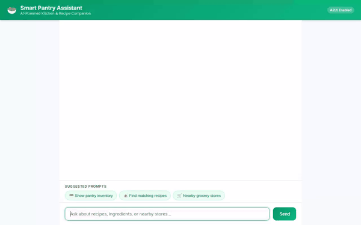

# Smart Pantry Assistant 🥗

An intelligent, conversational AI assistant built with Google Agent Development Kit (ADK) and Gemini to help home cooks manage their pantry inventory, discover personalized recipes, search nearby grocery stores, generate food media, and maintain dietary allergy memory across sessions.



---

## Features & Implemented Capabilities

- **🥗 Pantry Inventory Management**: Read and write pantry stock (item name, quantity, category) persisted in Google Cloud Firestore.
- **🍝 Recipe Discovery & Customization**: Search local Firestore recipe collection as well as real-time external recipes via TheMealDB API.
- **🧠 Persistent Allergy & Memory Bank**: Automatically extract and store user dietary restrictions, allergies, and preferences across sessions using Vertex AI Memory Bank.
- **🖼️ Image & Video Generation**:
  - Food image generation using `gemini-3.1-flash-lite-image` (Global Region).
  - Food prep video generation using `gemini-omni-flash-preview` (Global Region).
  - Automatic artifact saving to ADK Playground and direct byte stream uploads to Google Cloud Storage.
- **📍 Location & Supermarket Search**:
  - Address geocoding using Google Maps Geocoding API.
  - Search nearby grocery stores and supermarkets using Google Places API (New).
- **🎨 Adaptive UI (A2UI)**: Render structured, flat UI cards dynamically using A2UI (version 0.8) schema callbacks.
- **🐍 Code Execution Sandbox**: Execute Python code safely using `AgentEngineSandboxCodeExecutor` on Vertex AI Agent Engine.

---

## Google Cloud Services & Architecture

- **Vertex AI Agent Engine (Reasoning Engine)**: Host agent runtime, memory bank, and code execution sandbox (`us-east1`).
- **Vertex AI Memory Bank**: Cross-session durable fact store (`VertexAiMemoryBankService`).
- **Google Cloud Firestore**: NoSQL database for pantry inventory and recipe storage (`smart-pantry-db`).
- **Google Cloud Storage**: Public media asset bucket (`smart-pantry-assets-qwiklabs-gcp-03-9415c911d198`).
- **Gemini Models**:
  - `gemini-2.5-flash`: Core reasoning agent model.
  - `gemini-3.1-flash-lite-image`: Global image generation model.
  - `gemini-omni-flash-preview`: Global video generation model.
- **Google Maps Platform**: Geocoding API and Places API (New).

---

## Repository Structure

```
smart-pantry-agent/
├── app/
│   ├── __init__.py
│   ├── agent.py            # Main ADK agent declaration, tools, and callbacks
│   └── a2ui_utils.py       # A2UI callback parser and schema formatter
├── frontend/
│   ├── main.py             # FastAPI backend proxy connecting to Agent Engine
│   └── static/
│       └── index.html      # Rebranded chat UI with prompt chips & dialogue layout
├── agents-cli-manifest.yaml# Manifest defining app directory and configuration
├── pyproject.toml          # Python project dependencies
├── demo.webm               # Screen recording of agent interaction
└── demo.gif                # Optimized looping GIF of agent demo
```

---

## Local Setup & Development

### Prerequisites
- Python 3.10+
- Google Cloud SDK (`gcloud`) authenticated to your GCP project
- `uv` package manager (`pip install uv`)

### 1. Environment Setup
Create a `.env` file in the project root:
```bash
GOOGLE_CLOUD_PROJECT="<YOUR_GCP_PROJECT_ID>"
GOOGLE_CLOUD_LOCATION="us-east1"
GOOGLE_MAPS_API_KEY="<YOUR_GOOGLE_MAPS_API_KEY>"
THEMEALDB_API_KEY="1"
```

### 2. Run Agent Playground Locally
Start the ADK Web Playground with hot-reloading and Memory Bank integration:
```bash
uv run adk web . --port 8080 --reload_agents --memory_service_uri=agentengine://<YOUR_AGENT_ENGINE_ID>
```

### 3. Run Custom Frontend Proxy Locally
Install frontend dependencies and start the FastAPI proxy server:
```bash
cd frontend
pip install -r requirements.txt
export AGENT_ENGINE_RESOURCE_NAME="projects/<PROJECT_ID>/locations/us-east1/reasoningEngines/<ENGINE_ID>"
export AGENT_DIRECTORY="app"
python main.py
```
Open your web browser and navigate to port `8080` to interact with the Smart Pantry Assistant dialogue interface.
